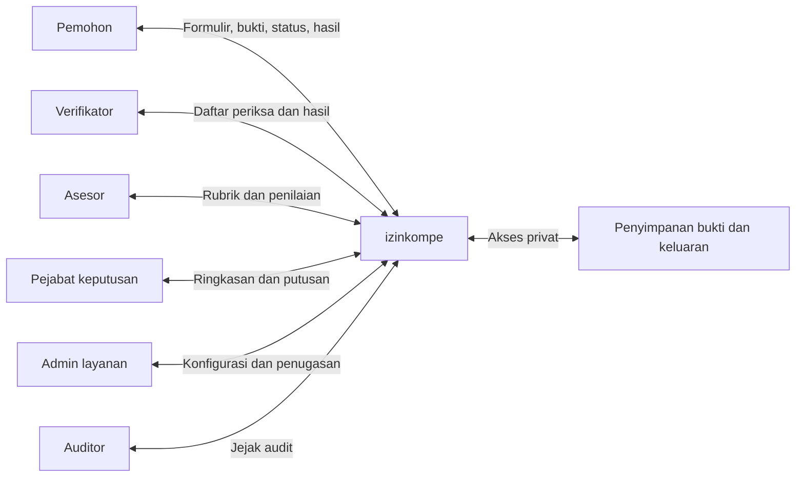
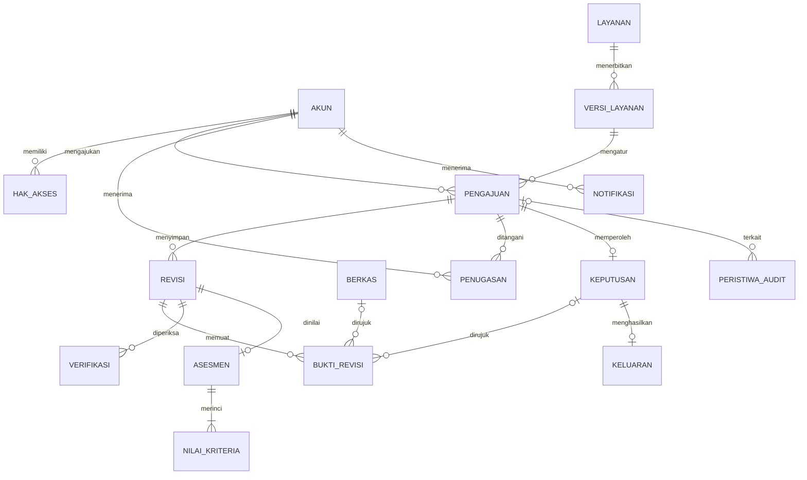
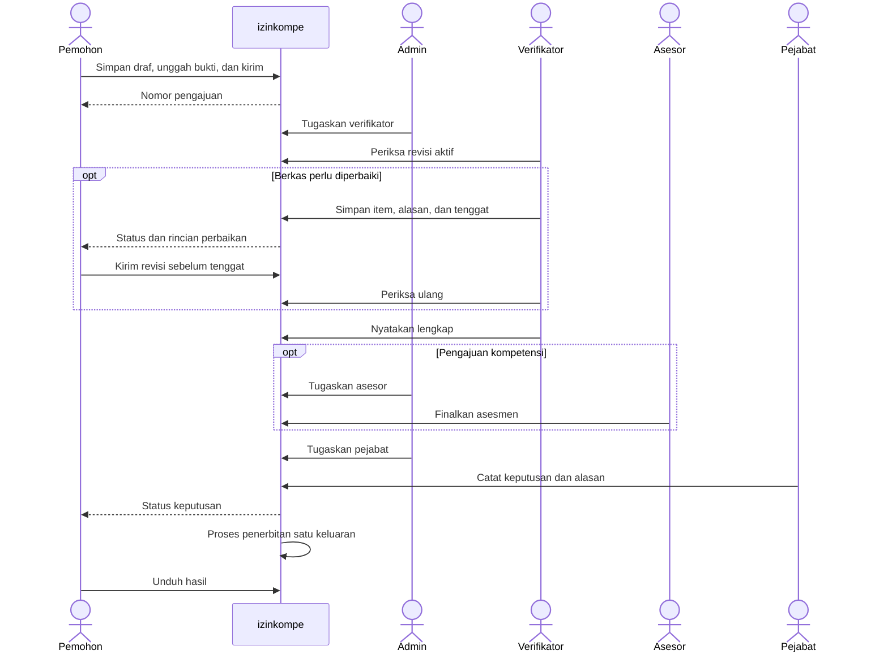

# Software Requirements Specification
## izinkompe

| Atribut | Keterangan |
| --- | --- |
| Versi | 0.1 |
| Status | Draf untuk validasi pemilik produk |
| Tanggal | 18 November 2026 |
| Penyusun dan organisasi | **[Perlu dilengkapi — P-01]** |
| Rilis sasaran | Produk layak minimum (MVP) |

## Daftar isi

1. [Pendahuluan](#1-pendahuluan)
2. [Gambaran umum produk](#2-gambaran-umum-produk)
3. [Kebutuhan](#3-kebutuhan)
4. [Verifikasi](#4-verifikasi)
5. [Lampiran](#5-lampiran)

## Riwayat revisi

| Versi | Tanggal | Penyusun | Perubahan |
| --- | --- | --- | --- |
| 0.1 | 18 November 2026 | **[Perlu dilengkapi — P-01]** | Penyusunan ruang lingkup, kebutuhan, model data, dan rencana verifikasi awal. |

## 1. Pendahuluan

### 1.1 Tujuan dokumen

Dokumen ini menetapkan perilaku, batas akses, antarmuka, model data logis, dan kriteria penerimaan izinkompe. Pemilik layanan menggunakannya untuk menyepakati ruang lingkup dan prosedur. Tim pengembang dan penguji menggunakannya sebagai acuan perancangan dan verifikasi.

### 1.2 Ruang lingkup produk

izinkompe dirancang untuk menerima pengajuan izin dan asesmen kompetensi berbasis bukti. Kedua layanan berbagi proses administrasi dan menghasilkan dokumen sesuai jenis layanan. Satu pengajuan memilih satu layanan. Dalam rancangan awal, suatu izin dapat mensyaratkan hasil kompetensi yang telah terbit apabila versi layanan menetapkannya.

MVP mencakup katalog, formulir, unggahan bukti, verifikasi, perbaikan, asesmen, keputusan, penerbitan, notifikasi internal, dan pelaporan. Ujian praktik, pembayaran, banding, perpanjangan, pencabutan, verifikasi publik, tanda tangan elektronik tersertifikasi, dan integrasi registri ditempatkan pada rilis lanjutan. **[Perlu dilengkapi — P-02, P-03]** Konfirmasi domain kompetensi, jenis izin, dan prosedur yang wajib masuk rilis pertama.

### 1.3 Definisi, akronim, dan singkatan

| Istilah | Definisi |
| --- | --- |
| Asesor | Petugas yang menilai bukti berdasarkan rubrik kompetensi. |
| Bukti | Berkas yang diajukan atau referensi hasil kompetensi yang dapat diperiksa. |
| Keputusan | Hasil akhir Disetujui atau Ditolak, beserta alasan dan identitas pejabat. |
| Keluaran | Dokumen izin, hasil kompetensi, atau pemberitahuan penolakan. |
| MVP | Produk layak minimum atau *minimum viable product*. |
| Revisi pengajuan | Salinan tetap formulir dan referensi bukti pada setiap pengiriman. |
| SRS | Spesifikasi kebutuhan perangkat lunak atau *software requirements specification*. |
| Versi layanan | Definisi berversi yang menetapkan formulir, bukti, rubrik, dan aturan keputusan. |

### 1.4 Referensi

| ID | Sumber | Kedudukan |
| --- | --- | --- |
| R-01 | jam01. *Software Requirements Specification Template*. Cabang master, diakses 18 November 2026. [Templat SRS](https://github.com/jam01/SRS-Template/blob/master/srs-template.md) | Informatif. Kerangka bab dan format kebutuhan. |
| R-02 | *PanganTani — Software Requirements Specification*. Versi 1.0, Proposal SEVENT X. Lampiran pengguna. | Informatif. Acuan kedalaman tabel, aturan proses, diagram, dan kontrak antarmuka. |
| R-03 | World Wide Web Consortium. *Web Content Accessibility Guidelines (WCAG) 2.2*. Edisi 12 Desember 2024. [Rekomendasi W3C](https://www.w3.org/TR/2024/REC-WCAG22-20241212/) | Acuan teknis untuk kriteria terpilih di REQ-INT-002. |
| R-04 | SOP, ketentuan penerbitan, matriks delegasi, dan jadwal retensi instansi. **[Perlu dilengkapi — P-03, P-04, P-06]** | Normatif setelah sumber dan keberlakuannya dikonfirmasi. |

### 1.5 Ikhtisar dokumen

Bab 2 memetakan fungsi, peran, batasan, dan tahapan rilis. Bab 3 merinci kewajiban sistem. Bab 4 menghubungkan setiap kebutuhan dengan rencana verifikasi. Bab 5 mendokumentasikan aturan proses dan asumsi yang perlu dikonfirmasi. Kata **harus** menandai kewajiban yang diusulkan untuk MVP. Penanda P-nn mengacu pada daftar isian di Lampiran E.

## 2. Gambaran umum produk

### 2.1 Perspektif produk

izinkompe merupakan aplikasi web baru. Sistem menerima permohonan, menyimpan bukti secara privat, mengarahkan pekerjaan sesuai kewenangan, dan menyediakan hasil kepada pemohon. Admin mengatur layanan dan penugasan, sedangkan pejabat menetapkan keputusan. **[Perlu dilengkapi — P-01, P-08]** Tetapkan instansi pengelola, layanan pendukung, dan jalur dukungan.

### 2.2 Fungsi produk

- Menampilkan layanan aktif dan syarat yang berlaku.
- Menyimpan draf, memeriksa bukti, dan merekam setiap revisi yang dikirim.
- Menugaskan petugas, mengelola perbaikan, dan menghitung rekomendasi kompetensi.
- Mencatat keputusan, menerbitkan keluaran, dan memberi tahu pihak terkait.
- Menyediakan laporan operasional serta riwayat tindakan untuk audit.

### 2.3 Batasan produk

| ID | Batasan | Dampak pada spesifikasi |
| --- | --- | --- |
| B-01 | Pembacaan dan perubahan data dibatasi oleh kepemilikan atau tugas dalam lingkup yang sah. | REQ-SEC-001 dan REQ-FUNC-006. |
| B-02 | Revisi yang terkirim dan keputusan final bersifat tetap selama masa retensinya. | REQ-FUNC-005, 008 dan 010. |
| B-03 | Keputusan mengikuti versi layanan dan mandat yang berlaku. | REQ-FUNC-010 dan REQ-COMP-003. |
| B-04 | Data identitas dan bukti ditangani sebagai data privat. | REQ-SEC-002 dan REQ-COMP-001–002. |
| B-05 | Alur utama bergantung pada koneksi internet. | Draf dapat dibuka kembali dan operasi pengiriman aman untuk dicoba ulang. |

### 2.4 Karakteristik pengguna

| Peran | Lingkup dan kebutuhan utama |
| --- | --- |
| Pemohon | Mengisi dan memantau pengajuan sendiri. Memerlukan petunjuk bukti, rincian perbaikan, dan hasil yang mudah diakses. |
| Verifikator | Memeriksa pengajuan yang ditugaskan. Memerlukan daftar periksa serta riwayat revisi. |
| Asesor | Menilai bukti kompetensi yang ditugaskan terhadap rubrik layanan. |
| Pejabat keputusan | Menetapkan keputusan untuk pengajuan yang ditugaskan dalam lingkup mandatnya. |
| Admin layanan | Mengelola katalog, hak dan penugasan dalam unit. Pembacaan bukti memerlukan peran operasional dan penugasan yang sah. |
| Auditor | Meninjau jejak audit dan ringkasan dalam cakupan yang diotorisasi. Akses ke isi bukti mengikuti prosedur khusus. |

### 2.5 Asumsi dan ketergantungan

| Asumsi awal | Dampak jika berubah |
| --- | --- |
| Pemohon individu bertindak untuk dirinya. | Dukungan kuasa atau badan usaha memerlukan model identitas dan mandat tambahan (P-02). |
| Satu instansi memiliki beberapa unit layanan. | Operasi lintas instansi memerlukan batas data, peran, dan konfigurasi terpisah (P-01, P-04). |
| Instansi menyediakan formulir, rubrik, templat, dan matriks kewenangan sebelum aktivasi. | Layanan terkait tetap dalam draf sampai bahan disahkan (P-03–P-05). |
| Bukti dapat diperiksa secara daring dan pemberitahuan internal diterima sebagai kanal MVP. | Persyaratan ujian fisik atau pemberitahuan resmi mengubah alur dan integrasi (P-02, P-03, P-08). |

### 2.6 Alokasi kebutuhan

| Tahap | Alokasi |
| --- | --- |
| MVP — pengajuan | Katalog, identitas, formulir, bukti, dan pengiriman (REQ-FUNC-001–005). |
| MVP — pemrosesan | Penugasan, verifikasi, perbaikan, asesmen, keputusan, penerbitan (REQ-FUNC-006–011). |
| MVP — pemantauan | Status, notifikasi, penarikan, audit, laporan (REQ-FUNC-012–015). |
| MVP — lintas fungsi | Antarmuka, mutu, kepatuhan, dan pengelolaan rilis (bagian 3.1 dan 3.3–3.5). |
| Rilis lanjutan | Integrasi dan tahapan tambahan pada bagian 1.2, setelah validasi SOP. |

## 3. Kebutuhan

ID kebutuhan bersifat tetap. Perubahan substansi kebutuhan dicatat menurut versi SRS dan ditelusuri ke kriteria penerimaan. Seluruh target kuantitatif dan aturan yang belum dikonfirmasi merupakan usulan rancangan.

### 3.1 Antarmuka eksternal

#### 3.1.1 Antarmuka pengguna

| ID | Ketentuan dan alasan | Kriteria penerimaan | Metode |
| --- | --- | --- | --- |
| REQ-INT-001 | Sistem harus menyediakan katalog, draf, pelacakan, kotak notifikasi, antrean, layar tugas, konfirmasi keputusan, dan unduhan sesuai peran. Setiap layar tugas menampilkan konteks pengajuan. | Kolom tidak valid diberi alasan dan cara memperbaikinya. Isian sah tetap tersedia. Konfirmasi menampilkan nomor dan hasil yang dipilih. Antrean memiliki keadaan kosong, pemuatan, dan gangguan. | Uji |
| REQ-INT-002 | Sistem harus menyediakan label, fokus terlihat, navigasi papan ketik, pesan status bagi pembaca layar, serta kontras teks biasa minimal 4,5:1 menurut R-03. | Alur pengajuan dapat diselesaikan dengan papan ketik. Pesan validasi terbaca pembaca layar. Isi berurutan tetap dapat diakses pada lebar 320 piksel CSS. | Uji dan inspeksi |

Bahasa awal antarmuka adalah bahasa Indonesia. Waktu ditampilkan dengan zona layanan yang eksplisit, dengan usulan Asia/Jakarta, sementara rekaman sistem memakai UTC. **[Perlu dilengkapi — P-07]** Tetapkan matriks peramban, bahasa, dan zona layanan.

#### 3.1.2 Antarmuka perangkat keras

| ID | Ketentuan dan alasan | Kriteria penerimaan | Metode |
| --- | --- | --- | --- |
| REQ-INT-003 | Sistem harus menerima berkas lokal melalui peramban komputer dan ponsel untuk mendukung bukti dari berbagai perangkat. | Berkas yang sah dapat dipilih tanpa izin kamera, lokasi, atau alat pemindai khusus. | Uji |

#### 3.1.3 Antarmuka perangkat lunak

| ID | Ketentuan dan alasan | Kriteria penerimaan | Metode |
| --- | --- | --- | --- |
| REQ-INT-004 | Pertukaran data harus memakai HTTPS dan mengikuti kontrak logis Lampiran D. Respons yang konsisten membantu pemulihan operasi. | Respons membedakan sesi berakhir, validasi gagal, objek di luar lingkup, konflik, dan gangguan sementara. Gangguan memuat ID korelasi. | Uji |

MVP memerlukan layanan identitas, penyimpanan privat, dan pemeriksaan berkas. **[Perlu dilengkapi — P-08]** Tentukan pemilik antarmuka, versi, autentikasi, kebijakan percobaan ulang, dan batas waktu masing-masing.

### 3.2 Kebutuhan fungsional

| ID | Fitur dan aktor | Ketentuan dan alasan | Kriteria penerimaan | Metode |
| --- | --- | --- | --- | --- |
| REQ-FUNC-001 | Akun — pemohon, admin | Sistem harus mengautentikasi akun aktif, membatasi akun baru pada hak pemohon, dan menyediakan pemulihan melalui kanal identitas terverifikasi. Admin memberi hak petugas menurut unit. | Pemohon baru tidak dapat membuka fungsi petugas. Akun nonaktif ditolak pada permintaan berikutnya. Tautan pemulihan kedaluwarsa atau sudah dipakai ditolak. | Uji |
| REQ-FUNC-002 | Katalog — admin, pemohon | Sistem harus menampilkan hanya versi layanan aktif kepada calon pemohon. Versi terbit membekukan formulir, tipe bukti, aturan keputusan dan rubrik jika relevan. | Konfigurasi wajib yang belum lengkap menahan aktivasi. Perubahan rubrik menerbitkan versi baru. Pengajuan bernomor masih memakai versi lama. | Uji |
| REQ-FUNC-003 | Draf — pemohon | Sistem harus menyimpan isian dan bukti dalam draf privat, serta memeriksa bidang wajib ketika pemohon mengirimnya. | Draf dapat dibuka pada sesi berikut. Isian wajib kosong ditandai. Perubahan dari tab dengan versi rekaman lama menghasilkan konflik. | Uji |
| REQ-FUNC-004 | Bukti — pemohon, sistem | Sistem harus memeriksa ukuran, isi berkas, dan hasil pemindaian sebelum bukti digunakan. Usulan awal menerima PDF, JPEG dan PNG hingga 10 MiB per berkas, satu berkas per item. **[Perlu dilengkapi — P-05, P-08]** | Berkas sah tepat 10 MiB lolos. Berkas lebih besar, jenis isi tidak cocok, dan berkas gagal pemindaian ditolak. Berkas yang masih dipindai menahan pengiriman. | Uji |
| REQ-FUNC-005 | Pengiriman — pemohon | Setelah validasi, sistem harus memberi nomor unik, menyimpan revisi pertama, mencatat waktu, dan memasukkan pengajuan ke antrean. | Pengulangan operasi yang sama mengembalikan nomor awal. Validasi gagal tidak membuat nomor maupun revisi parsial. | Uji |
| REQ-FUNC-006 | Penugasan — admin | Sistem harus menugaskan petugas aktif yang memiliki peran dan cakupan tahap terkait. Pengalihan menutup penugasan lama dan mencatat alasan. | Penugasan lintas unit tanpa mandat ditolak. Petugas lama kehilangan akses tugas pada permintaan berikutnya. | Uji |
| REQ-FUNC-007 | Verifikasi — verifikator | Sistem harus merekam hasil daftar periksa per revisi. Verifikator dapat menyatakan lengkap atau meminta perbaikan dengan item, alasan, dan tenggat. Hasil lengkap mengarahkan izin ke keputusan dan kompetensi ke asesmen. | Item wajib yang belum valid mencegah status lengkap. Dua item dapat dikembalikan dengan alasan berbeda. Catatan menunjuk revisi yang diperiksa. | Uji |
| REQ-FUNC-008 | Perbaikan — pemohon | Sistem harus membuka hanya item yang dikembalikan dan merekam revisi baru saat dikirim. Usulan tenggat adalah tujuh hari kalender dengan batas eksklusif pada jam setempat yang sama. **[Perlu dilengkapi — P-07]** | Pengiriman sebelum tenggat kembali ke verifikasi dengan revisi baru. Pengiriman tepat pada atau setelah tenggat ditolak meski pembaruan status terjadwal tertunda. | Uji |
| REQ-FUNC-009 | Asesmen — asesor | Sistem harus mencatat nilai, bukti acuan, dan catatan tiap kriteria. Rekomendasi dihitung dengan rubrik versi layanan menurut Lampiran A. Asesmen final dikunci. | Kriteria kosong menahan finalisasi. Skor tepat pada ambang lulus jika semua kriteria wajib juga terpenuhi. Kegagalan satu ambang wajib menghasilkan rekomendasi Belum memenuhi. | Uji |
| REQ-FUNC-010 | Keputusan — pejabat | Sistem harus menerima keputusan beralasan hanya pada tahap Menunggu keputusan, oleh pejabat berwenang. Persetujuan mensyaratkan prasyarat izin yang masih sah atau rekomendasi Memenuhi pada jalur kompetensi. Putusan menyimpan pejabat, waktu, revisi dan versi layanan. | Upaya tanpa mandat, tanpa alasan, atau tanpa prasyarat ditolak. Dua putusan bersamaan menghasilkan satu putusan final. | Uji |
| REQ-FUNC-011 | Penerbitan — sistem, pemohon | Sistem harus menerbitkan satu dokumen per putusan menggunakan versi templat terkait. Penolakan menghasilkan pemberitahuan beralasan. Gangguan penerbitan dapat dicoba ulang tanpa mengubah putusan. | Keluaran memuat nomor pengajuan, referensi putusan, jenis layanan, tanggal dan isi sesuai templat. Percobaan ulang menghasilkan satu nomor keluaran dan berkas dapat diunduh oleh pihak berwenang. | Uji |
| REQ-FUNC-012 | Status dan notifikasi — pemohon, petugas | Sistem harus menampilkan status, waktu, dan tindakan berikut. Notifikasi internal dipicu oleh penugasan, perbaikan, kedaluwarsa, keputusan, dan kesiapan dokumen. | Percobaan ulang menghasilkan paling banyak satu notifikasi per peristiwa dan penerima. Pemohon dapat membaca alasan perbaikan dan tenggat dari detail. | Uji |
| REQ-FUNC-013 | Penarikan — pemohon | Pemohon harus dapat menarik pengajuan milik sendiri sebelum putusan atau kedaluwarsa dengan menyertakan alasan. Sistem menutup tugas dan menyimpan riwayat. | Penarikan bersamaan dengan keputusan menghasilkan tepat satu transisi terminal. Putusan yang sudah tercatat menahan penarikan. | Uji |
| REQ-FUNC-014 | Audit — auditor | Sistem harus mencatat pengiriman, perubahan status dan hak, penugasan, pembacaan bukti oleh petugas, putusan, penerbitan dan ekspor. Catatan memuat pelaku, objek, aksi, waktu, hasil, dan ID korelasi. | Auditor berwenang dapat merunut urutan proses. Petugas operasional tidak dapat menyunting audit. Catatan tidak berisi token atau isi bukti. | Uji dan inspeksi |
| REQ-FUNC-015 | Laporan — admin, auditor | Sistem harus menghitung pengajuan unik menurut layanan, unit, status terkini dan periode pengiriman. Ekspor dibatasi sesuai lingkup pengguna. | Pengajuan dengan dua revisi dihitung sekali. Rentang memakai awal inklusif dan akhir eksklusif pada zona layanan. Ekspor sesuai filter tanpa isi bukti. | Uji |

### 3.3 Mutu layanan

**[Perlu dilengkapi — P-09]** Validasi beban, lingkungan representatif, dan sasaran mutu berikut sebelum menetapkan kriteria produksi.

#### 3.3.1 Kinerja

| ID | Ketentuan dan alasan | Kriteria penerimaan | Metode |
| --- | --- | --- | --- |
| REQ-PERF-001 | Waktu respons sisi layanan harus mencapai p95 ≤ 1 detik per operasi daftar, antrean, baca detail dan perubahan status untuk menjaga kelancaran pekerjaan petugas. | Uji dengan 10.000 pengajuan sintetis, 50 pengguna virtual selama 15 menit setelah 2 menit pemanasan. Kegagalan tak terduga < 1%. Transfer berkas diukur terpisah. | Uji beban |
| REQ-PERF-002 | Keluaran harus tersedia dengan p95 ≤ 60 detik setelah keputusan dalam kondisi normal. | Ukur 100 keputusan sintetis pada profil beban yang disepakati, dari simpan putusan hingga unduhan berhasil. | Uji beban |

#### 3.3.2 Keamanan

| ID | Ketentuan dan alasan | Kriteria penerimaan | Metode |
| --- | --- | --- | --- |
| REQ-SEC-001 | Server harus memeriksa sesi, peran, unit, penugasan atau kepemilikan, dan tahap. Petugas tidak boleh menangani pengajuannya sendiri. Pejabat harus berbeda dari verifikator dan asesor yang memfinalkan tahap sebelumnya. | Pembacaan lintas akun, akses lintas unit, dan keputusan oleh asesor pada pengajuan yang sama ditolak. | Uji |
| REQ-SEC-002 | Koneksi harus memakai HTTPS. Bukti dan cadangan harus terenkripsi saat disimpan dan setiap unduhan harus memeriksa kewenangan aktif. | Inspeksi mengonfirmasi enkripsi. Unduhan tanpa hak atau setelah pencabutan akses ditolak. Rahasia layanan tidak terdapat pada paket aplikasi. | Uji dan inspeksi |
| REQ-SEC-003 | Petugas harus memakai autentikasi multifaktor. Usulan sesi berakhir setelah tidak aktif selama 30 menit untuk membatasi akses dari perangkat yang ditinggalkan. | Sesi tanpa faktor kedua dan sesi di batas waktu tidak aktif ditolak. | Uji |

#### 3.3.3 Keandalan

| ID | Ketentuan dan alasan | Kriteria penerimaan | Metode |
| --- | --- | --- | --- |
| REQ-REL-001 | Transisi, catatan audit bisnis, serta perekaman pekerjaan penerbitan atau notifikasi harus disimpan secara atomik. Pengulangan operasi yang sama harus aman. | Kegagalan sebelum penyimpanan mempertahankan keadaan awal. Gangguan setelah penyimpanan sebelum respons menghasilkan satu keadaan akhir yang dapat dibaca ulang. | Uji |
| REQ-REL-002 | Cadangan catatan dan berkas harus dapat dipulihkan dengan kehilangan data maksimal 24 jam dan durasi pemulihan maksimal 4 jam. | Pemulihan cadangan di lingkungan uji mengembalikan data, berkas, keputusan, dan hubungan antarentitas dalam batas usulan. | Uji pemulihan |

#### 3.3.4 Ketersediaan

| ID | Ketentuan dan alasan | Kriteria penerimaan | Metode |
| --- | --- | --- | --- |
| REQ-AVAIL-001 | Jalur autentikasi dan pembacaan pengajuan uji harus mencapai 99,5% tersedia per bulan, diukur sekali per menit. | Persentase dihitung dari pemeriksaan berhasil dibagi semua menit. Pemeriksaan tanpa hasil dan pemeliharaan terencana dihitung dalam waktu gagal. | Analisis dan uji |

#### 3.3.5 Observabilitas

| ID | Ketentuan dan alasan | Kriteria penerimaan | Metode |
| --- | --- | --- | --- |
| REQ-OBS-001 | Telemetri harus mencatat operasi, hasil, latensi, waktu dan korelasi. Peringatan muncul setelah tiga pemeriksaan kesehatan gagal berturut-turut atau penerbitan tertunda lebih dari lima menit. | Simulasi gangguan memicu peringatan dan rekaman dapat dicari per korelasi tanpa memuat nama, bukti, atau token. | Uji dan inspeksi |

### 3.4 Kepatuhan

R-04 menetapkan sumber kewajiban instansi. **[Perlu dilengkapi — P-03, P-06]** Identifikasi dasar pemrosesan, hak subjek data, retensi, kewenangan penerbitan, dan format pemberitahuan sebelum menyetujui spesifikasi.

| ID | Ketentuan dan alasan | Kriteria penerimaan | Metode |
| --- | --- | --- | --- |
| REQ-COMP-001 | Sistem harus menampilkan pemberitahuan privasi berversi yang disahkan sebelum pengiriman dan menyimpan versi yang ditampilkan. | Pemberitahuan memuat tujuan, kelas data, dan kanal permintaan sesuai kebijakan. Revisi dapat ditelusuri ke versi pemberitahuan. | Inspeksi dan uji |
| REQ-COMP-002 | Sistem harus menerapkan jadwal retensi per kelas data, termasuk arsip dan cadangan, serta menunda pemusnahan yang berada dalam penahanan sah. | Data sintetis diproses sesuai jadwal. Objek dalam penahanan dipertahankan. Audit mencatat pemusnahan tanpa menyalin isi. | Inspeksi dan uji |
| REQ-COMP-003 | Aktivasi layanan harus mensyaratkan pengesahan templat dan kewenangan pejabat. | Versi yang belum disahkan gagal diaktifkan. Dokumen uji dapat ditelusuri ke templat dan mandat yang digunakan. | Inspeksi dan uji |

### 3.5 Perancangan dan implementasi

**[Perlu dilengkapi — P-08, P-10]** Tetapkan lingkungan sasaran, jadwal, pagu dan kepemilikan operasi.

#### 3.5.1 Instalasi
- **REQ-INST-001 — Instalasi dan pemulihan.** Paket harus menyertakan prosedur konfigurasi, migrasi dan pemulihan. Tim mendemonstrasikan instalasi pada lingkungan kosong dan pemulihan migrasi menggunakan data sintetis.

#### 3.5.2 Pembuatan paket dan pengiriman
- **REQ-BUILD-001 — Jejak rilis.** Paket harus dapat ditelusuri ke revisi sumber dan versi dependensi. Inspeksi memastikan paket yang dipromosikan memiliki identitas yang sama dengan paket yang lulus uji.

#### 3.5.3 Distribusi
- **REQ-DIST-001 — Batas distribusi.** Titik masuk aplikasi harus dipisahkan dari akses langsung ke penyimpanan bukti dan administrasi. Inspeksi diagram serta uji jaringan memastikan batas tersebut dan mencatat letak cadangan.

#### 3.5.4 Kemudahan pemeliharaan
- **REQ-MAINT-001 — Prosedur operasi.** Tim operasi harus memiliki prosedur penerbitan ulang, pemulihan, dan respons insiden agar tindakan dapat diulang. Operator mendemonstrasikan penanganan dokumen tertunda dan penelusuran versi layanan.

#### 3.5.5 Penggunaan ulang
- **REQ-REUSE-001 — Konfigurasi layanan.** Mekanisme formulir, bukti dan verifikasi harus dapat digunakan untuk layanan baru yang mengikuti pola MVP. Demonstrasikan dua jenis izin dengan persyaratan berbeda melalui konfigurasi.

#### 3.5.6 Portabilitas
- **REQ-PORT-001 — Lingkungan dan migrasi.** Paket yang sama harus berjalan dengan konfigurasi berbeda pada lingkungan uji dan produksi. Demonstrasikan pemasangan pada dua lingkungan dan migrasi data sampel dengan relasi berkas yang utuh.

#### 3.5.7 Biaya
- **REQ-COST-001 — Estimasi operasi.** Sebelum rilis, tim harus menyusun estimasi biaya operasi normal dan puncak dari komputasi, penyimpanan, transfer, pemeriksaan berkas dan lisensi. Analisis harus dapat dihitung ulang dari volume dan tarif serta dibandingkan dengan pagu P-10.

#### 3.5.8 Jadwal
- **REQ-DEAD-001 — Tonggak.** Rencana harus menempatkan validasi SOP dan rubrik sebelum implementasi alur final, lalu verifikasi internal, uji penerimaan dan persetujuan rilis. Inspeksi memeriksa tanggal, pemilik dan syarat selesai tiap tonggak.

#### 3.5.9 Pembuktian konsep
- **REQ-POC-001 — Purwarupa alur kritis.** Tim harus mendemonstrasikan perbaikan, akses petugas, prasyarat kompetensi, dan keputusan serentak dengan data sintetis. Keempat skenario menghasilkan catatan hasil dan keputusan tindak lanjut sebelum desain ditetapkan.

#### 3.5.10 Pengelolaan perubahan
- **REQ-CM-001 — Perubahan terkendali.** Perubahan kebutuhan, konfigurasi, kontrak dan data harus memiliki persetujuan, catatan dampak dan prosedur pemulihan apabila berlaku. Inspeksi dan uji rubrik baru harus menunjukkan versi baru serta keterbacaan asesmen lama.

### 3.6 Kecerdasan buatan dan pembelajaran mesin

MVP memakai validasi deterministik dan keputusan manusia. Penerapan model pada rilis berikutnya harus melalui REQ-CM-001.

#### 3.6.1 Spesifikasi model
Tidak berlaku untuk MVP. Rekomendasi memakai perhitungan pada Lampiran A.

#### 3.6.2 Pengelolaan data
Tidak berlaku untuk pelatihan model. Bukti operasional tunduk pada REQ-COMP-002.

#### 3.6.3 Pengendalian model
Tidak berlaku untuk MVP. Pemeriksaan masukan, izin, dan transisi mengikuti bagian 3.1–3.3.

#### 3.6.4 Etika
Tidak berlaku sebagai evaluasi model. Pertanggungjawaban penilaian mengikuti rubrik berversi, alasan keputusan, dan audit.

#### 3.6.5 Keterlibatan manusia
Tidak berlaku sebagai pengawasan keluaran model. Tanggung jawab verifikator, asesor dan pejabat diatur pada bagian 2.4 dan 3.2.

#### 3.6.6 Siklus hidup dan operasi model
Tidak berlaku untuk MVP. Penambahan model memerlukan spesifikasi, penilaian dampak dan rencana verifikasi tersendiri.

## 4. Verifikasi

Gunakan lingkungan terpisah dengan minimal dua pemohon, dua unit, petugas dengan hak berbeda, versi lama dan baru, bukti sah dan gagal, serta waktu uji terkontrol. Setiap kasus mencatat lingkungan, konfigurasi, langkah, hasil aktual, keputusan lulus atau gagal, dan tautan bukti setelah tersedia.

| Kasus | Kebutuhan | Bukti yang direncanakan | Status |
| --- | --- | --- | --- |
| V-01 | REQ-INT-001, REQ-INT-002, REQ-INT-003 | Catatan lintas perangkat, papan ketik, pembaca layar dan pengukuran kontras. | Direncanakan |
| V-02 | REQ-INT-004, REQ-FUNC-001, REQ-SEC-001, REQ-SEC-002, REQ-SEC-003 | Hasil kontrak respons, pemulihan akun, penolakan akses silang, sesi dan inspeksi enkripsi. | Direncanakan |
| V-03 | REQ-FUNC-002, REQ-FUNC-003, REQ-FUNC-004, REQ-FUNC-005 | Bukti aktivasi versi, konflik draf, pemeriksaan berkas pada batas, dan nomor tunggal saat pengiriman ulang. | Direncanakan |
| V-04 | REQ-FUNC-006, REQ-FUNC-007, REQ-FUNC-008 | Riwayat pengalihan, hasil daftar periksa, serta pengujian sebelum dan tepat pada tenggat. | Direncanakan |
| V-05 | REQ-FUNC-009, REQ-FUNC-010, REQ-FUNC-011 | Hasil uji ambang, prasyarat izin, putusan serentak dan satu keluaran setelah percobaan ulang. | Direncanakan |
| V-06 | REQ-FUNC-012, REQ-FUNC-013, REQ-FUNC-014, REQ-FUNC-015 | Riwayat status, notifikasi ganda, konflik penarikan, jejak audit dan rekonsiliasi hitungan laporan. | Direncanakan |
| V-07 | REQ-PERF-001, REQ-PERF-002, REQ-AVAIL-001, REQ-OBS-001 | Distribusi latensi, laporan hasil pemeriksaan layanan, dan peringatan yang dipicu. | Direncanakan |
| V-08 | REQ-REL-001, REQ-REL-002 | Hasil simulasi gangguan, pemulihan cadangan, dan pemeriksaan konsistensi. | Direncanakan |
| V-09 | REQ-COMP-001, REQ-COMP-002, REQ-COMP-003 | R-04 yang disahkan, hasil uji retensi serta penelusuran templat dan mandat. | Direncanakan |
| V-10 | REQ-INST-001, REQ-BUILD-001, REQ-DIST-001, REQ-MAINT-001 | Identitas artefak, bukti instalasi, migrasi, batas jaringan dan demonstrasi operasi. | Direncanakan |
| V-11 | REQ-REUSE-001, REQ-PORT-001, REQ-CM-001 | Hasil demonstrasi layanan kedua, pemindahan data, dan keterbacaan hasil versi lama. | Direncanakan |
| V-12 | REQ-COST-001, REQ-DEAD-001, REQ-POC-001 | Model biaya, jadwal dan hasil empat skenario purwarupa. | Direncanakan |

Penerimaan MVP mensyaratkan terpenuhinya kriteria pada Bab 3, persetujuan pemilik layanan atas keputusan terbuka, dan bukti uji pengguna untuk kedua jalur layanan. Pengujian perangkat lunak baru dapat dilakukan setelah sistem tersedia.

## 5. Lampiran

### Lampiran A. Status dan aturan proses

| Status asal | Pemicu | Syarat dan status tujuan |
| --- | --- | --- |
| Draf | Pemohon mengirim | Formulir dan bukti sah. Sistem memberi nomor dan revisi pertama, lalu status Diajukan. |
| Diajukan | Admin menugaskan | Penugasan sah membawa pengajuan ke Dalam verifikasi. |
| Dalam verifikasi | Verifikator meminta perbaikan | Item, alasan dan tenggat tercatat. Status Perlu perbaikan. |
| Perlu perbaikan | Pemohon mengirim revisi | Waktu server kurang dari tenggat. Revisi baru kembali ke Dalam verifikasi jika penugasan masih sah, atau Diajukan jika perlu penugasan baru. |
| Perlu perbaikan | Waktu mencapai tenggat | Status Kedaluwarsa. Permintaan perubahan ditolak sejak batas tercapai. |
| Dalam verifikasi | Verifikator menyatakan lengkap | Izin menuju Menunggu keputusan. Kompetensi menuju Dalam asesmen. |
| Dalam asesmen | Asesor memfinalkan | Semua nilai lengkap dan penugasan sah. Status Menunggu keputusan. |
| Menunggu keputusan | Pejabat menetapkan hasil | Hasil Disetujui atau Ditolak disimpan bersama pekerjaan penerbitan. |
| Tahap aktif setelah pengiriman | Pemohon menarik | Syarat REQ-FUNC-013 terpenuhi. Status Ditarik dan tugas ditutup. |

Empat status terminal adalah Disetujui, Ditolak, Ditarik, dan Kedaluwarsa. Status penerbitan terpisah, yaitu Menunggu, Tersedia, atau Gagal sementara. Pemohon dapat melihat putusan segera setelah tercatat. Gangguan penerbitan hanya mengubah status pekerjaan penerbitan.

Draf memakai versi aktif saat dibuat. Jika layanan berganti versi sebelum pengiriman pertama, sistem meminta pemohon membuat draf pada versi aktif. Pengajuan bernomor mempertahankan versi awal sampai akhir. Untuk izin yang mensyaratkan kompetensi, periksa pemilik, jenis kompetensi, keberadaan keluaran yang disetujui, dan masa berlaku saat pengiriman serta sebelum persetujuan. **[Perlu dilengkapi — P-05]** Tentukan apakah SOP mengizinkan pembaruan bukti setelah pemeriksaan akhir.

Rubrik berisi nilai 0–100, bobot positif dengan jumlah 100%, ambang umum dan ambang tiap kriteria wajib. Skor dihitung dengan Σ(nilai × bobot) / 100. Perbandingan memakai skor sebelum pembulatan tampilan. Rekomendasi Memenuhi mensyaratkan skor dan semua kriteria wajib mencapai ambangnya. Contoh sintetis berbobot 60% dan 40% dengan nilai 80 dan 70 menghasilkan skor 76. Jika ambang umum 75 dan ambang kriteria kedua 75, hasilnya Belum memenuhi. **[Perlu dilengkapi — P-05]** Isi bobot, ambang dan masa berlaku resmi.

### Lampiran B. Model data logis

| Entitas | Atribut minimum dan aturan |
| --- | --- |
| Akun dan hak akses | Identitas, kontak terverifikasi, status, peran, unit, masa efektif. Penonaktifan mempertahankan identitas historis. |
| Layanan dan versi | Kode, unit, jenis, versi, status, formulir, daftar bukti, templat, rubrik dan aturan keputusan. Satu versi aktif per layanan. |
| Pengajuan | ID internal, nomor pelacakan unik setelah pengiriman, pemohon, versi layanan, status, revisi aktif, versi rekaman, waktu pengiriman. |
| Revisi | ID pengajuan, urutan unik per pengajuan, isian, versi pemberitahuan privasi dan waktu. Revisi tetap setelah dikirim. |
| Berkas dan bukti revisi | Pemilik, lokasi objek privat, ukuran, jenis, status pemindaian. Tiap item bukti menautkan tepat satu berkas atau satu keputusan kompetensi yang memenuhi syarat. |
| Penugasan | Pengajuan, tahap, petugas, unit, masa aktif dan alasan pengalihan. Maksimal satu tugas aktif per tahap pengajuan. |
| Verifikasi | Revisi, penugasan, hasil per item, alasan, tenggat, waktu finalisasi. Maksimal satu hasil final per revisi. |
| Asesmen dan nilai | Revisi, rubrik, asesor, nilai per kriteria, bukti acuan, catatan, rekomendasi. Nilai tiap kriteria unik dalam satu asesmen. |
| Keputusan dan keluaran | Putusan per pengajuan unik. Simpan revisi dari pengajuan yang sama, pejabat, lingkup mandat, hasil, alasan, waktu, nomor dan templat keluaran. |
| Audit dan notifikasi | Peristiwa, pelaku, aksi, objek, hasil, waktu, korelasi. Notifikasi unik menurut pasangan peristiwa dan penerima. |

### Lampiran C. Alur interaksi

Halaman yang kedaluwarsa memerlukan pemuatan ulang sebelum tindakan dapat diulang. Jika pengiriman berhasil sebelum koneksi putus, percobaan ulang mengembalikan nomor dan revisi yang sama. Jika tenggat terlewati atau penerbitan gagal, antarmuka menampilkan keadaan yang tercatat serta tindakan yang masih tersedia.

### Lampiran D. Kontrak antarmuka logis

| Operasi | Data masuk | Hasil dan kondisi khusus |
| --- | --- | --- |
| Baca katalog | Filter jenis opsional. | Layanan aktif, versi, syarat, atau hasil kosong. |
| Simpan draf | ID bila ada, versi layanan, isian, versi rekaman. | Draf terkini. Konflik bila versi penyimpanan sudah berubah. |
| Unggah bukti | ID draf atau pengajuan dalam perbaikan, item, berkas. | ID bukti dan status pemeriksaan. Penolakan menyebut kategori masalah. |
| Kirim pengajuan atau revisi | ID, versi rekaman, kunci pengulangan. | Nomor, revisi, status, atau rincian validasi. Versi usang dan tenggat lewat memicu konflik. |
| Tindakan petugas | ID, penugasan, versi rekaman, aksi dan data. | Status dan versi baru jika sah. Akses dan tahap diperiksa ulang. |
| Tetapkan keputusan | ID, versi rekaman, hasil, alasan dan kunci pengulangan. | ID keputusan, status pengajuan dan penerbitan. |
| Unduh keluaran | ID pengajuan dan sesi aktif. | Dokumen terotorisasi atau status penerbitan bila belum tersedia. |

Kunci pengulangan dibatasi oleh pengguna dan jenis operasi. Setelah pemeriksaan hak, sistem memeriksa kesamaan masukan sebelum memeriksa versi rekaman terbaru. Kunci dengan masukan berbeda menghasilkan konflik. **[Perlu dilengkapi — P-08]** Tetapkan masa simpan kunci, skema pesan, versi antarmuka, dan batas ukuran permintaan.

### Lampiran E. Isian dan keputusan terbuka

| ID | Isian yang diperlukan | Penanggung jawab usulan | Dampak |
| --- | --- | --- | --- |
| P-01 | Penyusun, instansi, unit, pemilik produk, kontak dan jalur dukungan. | Pemilik produk | Identitas dokumen dan lingkup organisasi. |
| P-02 | Jenis izin, domain kompetensi, pengguna sasaran, penggunaan kuasa dan hubungan antarlayanan. | Pemilik layanan | Cakupan MVP dan prasyarat. |
| P-03 | SOP, rujukan normatif, delegasi, penerbitan, tanda tangan, pemberitahuan dan koreksi keputusan. | Pengelola dan pejabat | Proses serta kedudukan keluaran. |
| P-04 | Matriks peran, unit, pemisahan tugas, hak auditor, pengalihan dan konflik kepentingan. | Pengelola akses | Aturan otorisasi dan penugasan. |
| P-05 | Formulir, bukti, rubrik dan ambang, masa berlaku, templat, dan ketentuan pembaruan bukti. | Verifikator, asesor dan pejabat | Konfigurasi dan uji kelayakan. |
| P-06 | Kebijakan privasi, jadwal retensi, hak subjek data, arsip dan pemusnahan. | Pengelola privasi dan arsip | Siklus hidup data. |
| P-07 | Zona, bahasa, peramban, tenggat, kalender kerja, dan target tiap tahap. | Pengelola operasional | Tampilan, perhitungan waktu, dan laporan. |
| P-08 | Platform, lokasi data, identitas, penyimpanan, pemindaian, notifikasi dan kontrak integrasi. | Tim teknis | Antarmuka dan operasi. |
| P-09 | Beban layanan, sasaran respons dan ketersediaan, toleransi kehilangan data serta durasi pemulihan. | Pemilik layanan dan operasi TI | Kapasitas dan rancangan verifikasi. |
| P-10 | Pagu, tonggak, durasi purwarupa, penanggung jawab uji penerimaan dan tanggal rilis. | Pemilik produk | Estimasi dan kesiapan rilis. |

### Lampiran F. Pemetaan acuan format

| Unsur lampiran acuan | Penerapan pada izinkompe |
| --- | --- |
| Perspektif, peran, asumsi | Bab 2 mengikuti urutan kerangka R-01. |
| Tabel kebutuhan, logika bisnis, dan skenario gagal | Bab 3 dan Lampiran A. |
| Sasaran terukur dan kebijakan akses | Bagian 3.3 dan matriks Bab 4. |
| ERD, kamus data, dan diagram interaksi | Lampiran B dan C. |
| Antarmuka pengguna, perangkat, dan kontrak | Bagian 3.1 dan Lampiran D. |
